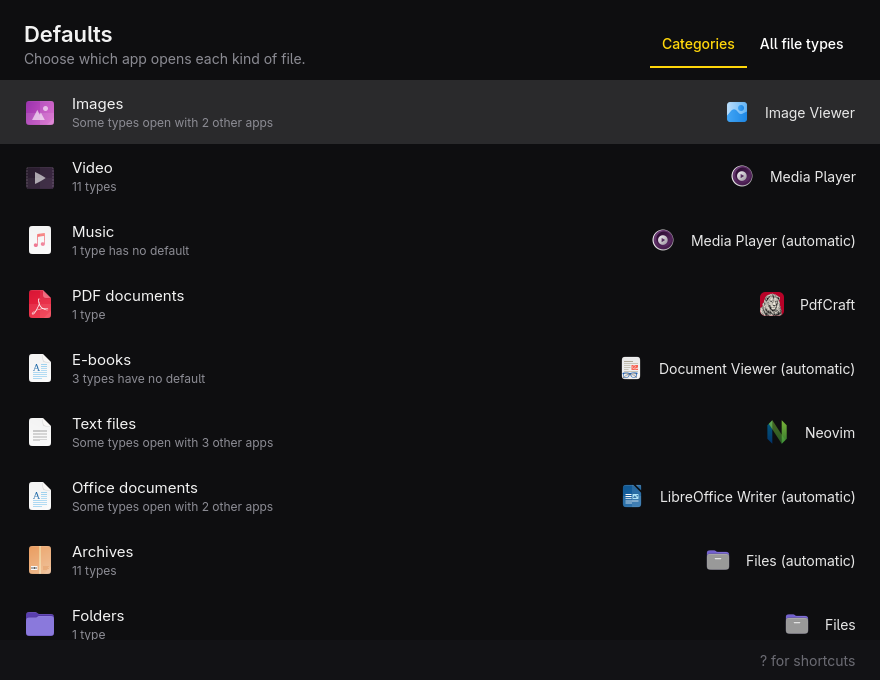

# Defaults

Choose which app opens each kind of file on [Omarchy](https://omarchy.org).



Omarchy's menu already sets your browser, editor and terminal (Setup › Defaults). Defaults covers everything else: images, video, music, PDFs, e-books, text files, office documents, archives, folders and email links. You can also open the **All file types** view to set any single type, like `.webp` or `.mkv`.

- Each category shows the app that opens it now. It's marked **automatic** when nobody picked it and it's only the app `xdg-open` falls back to.
- The picker lists only installed apps that can open those files, the ones that open the most types first. Choosing an app for a category sets it for every type in that category it can open and leaves the rest alone.
- Changes go to `~/.config/mimeapps.list` right away. Only the `[Default Applications]` lines for the types you change are touched. Each type is written under all its names (`video/matroska` and `video/x-matroska`), so every tool finds it. The file is written beside the original and then renamed into place.
- Web links stay with Omarchy. It routes them through `~/.config/hyprland-mimeapps.list`, which is read before your own list, so those types are shown as **(Omarchy)** and left alone.
- It follows the Omarchy theme accent, window rounding and language live.

## Install

```bash
cd defaults
bin/install
```

That builds an Arch package and installs it, so **Defaults** shows up in the app launcher (Super + Space). It needs `qmake6`, `make` and Qt 6, which Omarchy already has.

To remove it: `sudo pacman -R defaults`. Your `mimeapps.list` keeps the defaults you set.

## Keyboard

| Key | Action |
|---|---|
| ↑ ↓ | Move through the list |
| Enter / Space | Choose the app for the selected row |
| Tab | Switch between Categories and All file types |
| / | Search file types by name, extension or app |
| Ctrl+Z / Ctrl+Shift+Z | Undo / redo |
| F5 | Reload apps and defaults |
| ? | Show all shortcuts |
| Q | Quit |

## Command line

The same thing works without a window, for scripts and agents. Every command takes `--json`, exits 0 on success, and prints errors to stderr.

```bash
defaults list                      # each category and what opens its types
defaults types                     # every known file type
defaults get pdf                   # or a MIME type: defaults get image/png
defaults apps images               # installed apps that can open images
defaults set images imv.desktop    # make imv open every image type it supports
```

## Development

```bash
bin/build     # build/defaults
bin/test      # unit tests, offscreen, in temporary XDG directories
bin/install   # build and install the package
```

## License

MIT. The theme, translator and build scaffolding follow Omacut and Monologue by David Heinemeier Hansson (MIT).
